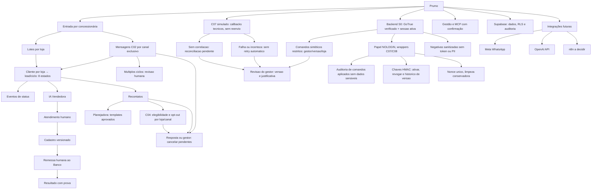

# Prumo — mapa mental simples

S0 fundação: telefone de cliente pode existir em A/B/C com históricos isolados; emissor Prumo exclusivo por loja; importação C01, ingresso C02, elegibilidade C04, planos C05 e cancelamento C08 simulados com eventos e idempotência; nenhuma transmissão externa. S0 testes sintéticos; S1 operação humana/banco simulados; S2 IA/Meta simulados; S3 MCP controlado; S4 ativação real somente por autorização específica. Não há IA Analista autônoma. Nenhum dado cruza lojas.
