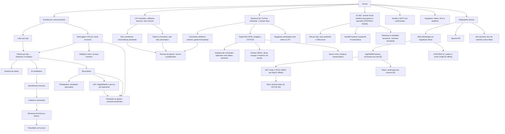
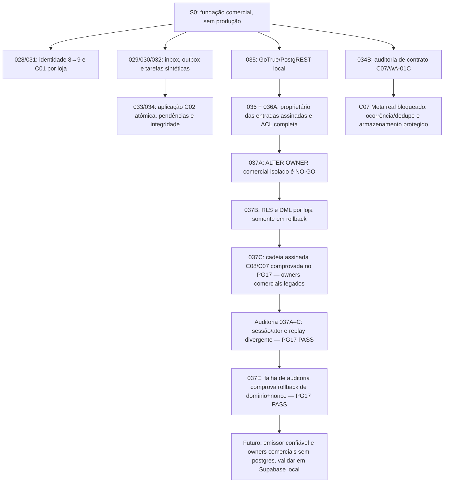
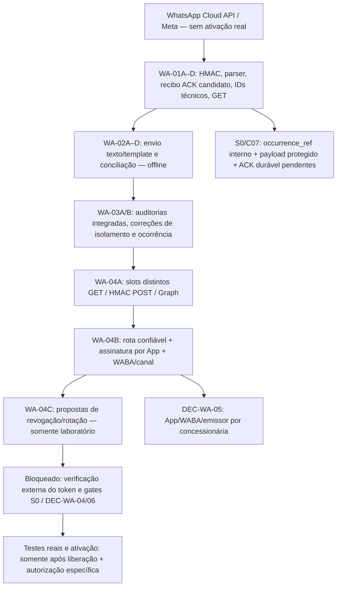

# Prumo — mapa mental simples

S0 fundação: telefone de cliente pode existir em A/B/C com históricos isolados; emissor Prumo exclusivo por loja; importação C01, ingresso C02, elegibilidade C04, planos C05 e cancelamento C08 simulados com eventos e idempotência; nenhuma transmissão externa. S0 testes sintéticos; S1 operação humana/banco simulados; S2 IA/Meta simulados; S3 MCP controlado; S4 ativação real somente por autorização específica. Não há IA Analista autônoma. Nenhum dado cruza lojas.

## Linha do tempo S0 auditada — 18/10/2026

### Decisões e fronteiras

- **[D] DEC-WA-01/02/03:** variantes telefônicas brasileiras com e sem nono dígito são aliases do mesmo contato **quando a associação é confiável e não ambígua na mesma loja**; o mesmo telefone pode existir em outras concessionárias com histórico independente. Reutilizar o domínio S0 e manter inbox/outbox transacionais. Nenhuma fusão automática de pessoas em conflito ou compartilhamento de histórico entre lojas.
- **[D] DEC-WA-05:** App/WABA/número emissor Meta pertencem à concessionária; a Prumo integra sob autorização. Um emissor é atribuído a apenas uma loja por vigência. Não modificar canais comerciais por inferência.
- **[P] WA-01C:** `statuses[].id` é ID da mensagem enviada, **não** ID único de ocorrência do callback; `status+timestamp` não prova deduplicação. C07 real permanece não integrado à inbox.
- **[R] DEC-WA-04/06:** ambiente definitivo, segredos, proteção/retensão de payload, recibo/ACK operacional e recuperação ainda exigem definição/autorização. A POC Meta não autoriza operação comercial.
- **[D] Meta → Supabase direto como direção de integração:** Edge Function autentica a origem, persistência durável antes de ACK, worker controlado, outbox e Graph; n8n opcional fora do caminho crítico, não um componente obrigatório.
- **[D] Oito estados comerciais somente:** `aguardando primeiro disparo`, `primeiro disparo enviado`, `em atendimento pela IA`, `em atendimento pelo operador`, `cadastro enviado ao operador`, `cadastro enviado ao banco`, `vendido`, `perdido`. `APPLIED`, `QUARANTINED`, estados Meta e leases são técnicos, não comerciais.
- **[R] Menor privilégio comercial integral:** gateway e assinador têm papéis NOLOGIN isolados; as **duas wrappers comerciais legadas ainda pertencem a `postgres`**. S0-037A/037B não autorizaram a transferência. S0-037C testa a cadeia existente, não instala papel operacional novo.
- **[Gate]** GitHub PR #1 e PR #2 permanecem Draft, sem merge; testes PostgreSQL descartável e Supabase Auth/REST local quando necessários; Supabase hospedado não recebeu as migrations comerciais, sem envio Meta/Banco real, nenhum plano pago ou deploy autorizado.

### Marcos e evidências

| Marco | Escopo | Evidência |
| --- | --- | --- |
| S0-033/034A | C02 ligado à inbox em uma transação; prova de conclusão, conflito de identidade durável e FKs por canal | PG17 aprovado, testes WA33/WA34 |
| S0-034B | C07 callbacks sintéticos, preservação de observações e dedupe **não operacional** | [CI #39119612194](https://github.com/prumogrowth/Prumo-Growth---Platform/actions/runs/39119612194) |
| S0-035 | GoTrue/PostgREST local para 028–034 | [CI #39120161917](https://github.com/prumogrowth/Prumo-Growth---Platform/actions/runs/39120161917) |
| S0-036/036A | Entradas assinadas com owner restrito, inventário completo de ACL | [CI #39122948236](https://github.com/prumogrowth/Prumo-Growth---Platform/actions/runs/39122948236) |
| S0-037A | Guard `current_user=postgres` e RLS bloqueiam transferência isolada | [CI #39123912355](https://github.com/prumogrowth/Prumo-Growth---Platform/actions/runs/39123912355) |
| S0-037B | Policies artificiais por loja e DML C07/C08 descartável | [CI #39126117200](https://github.com/prumogrowth/Prumo-Growth---Platform/actions/runs/39126117200) |
| S0-037C | Regressão do caminho assinado com HMAC, sessão, nonce, C08 e duas decisões C07 | [CI #39127146330 — SUCCESS](https://github.com/prumogrowth/Prumo-Growth---Platform/actions/runs/39127146330) |
| Auditoria S0-037A/B/C | Sessão e ator distintos, gestor interloja, replay C07 idêntico/divergente | [CI #39128133133 — SUCCESS](https://github.com/prumogrowth/Prumo-Growth---Platform/actions/runs/39128133133) |
| S0-037D | Capacidade de laboratório por operação/loja/alvo/versão/txid; GUC falsificada não é autorização | [CI #39130042204 — SUCCESS](https://github.com/prumogrowth/Prumo-Growth---Platform/actions/runs/39130042204) — **não é redução do owner comercial** |
| S0-037E | Falha de auditoria após C08/C07, rollback de domínio/nonce e retry com prova idêntica | [CI #39130947663 — SUCCESS](https://github.com/prumogrowth/Prumo-Growth---Platform/actions/runs/39130947663) — **owners comerciais continuam postgres** |
| S0-037F | Executor assinado NOLOGIN/NOBYPASSRLS sobre **tabelas de laboratório**, HMAC real do signer e sessão mock, capacidade RLS, auditoria/rollback | [CI #39131575891 — SUCCESS](https://github.com/prumogrowth/Prumo-Growth---Platform/actions/runs/39131575891) — **não transferiu owners comerciais** |

**S0-037D testada no PostgreSQL 17:** capability de teste emitida pela fixture privilegiada, consumida em política RLS transacional sem confiar em GUC de sessão. Não há emissor autenticado e nem substituição das wrappers comerciais `postgres`. [CI PG17 #39130042204](https://github.com/prumogrowth/Prumo-Growth---Platform/actions/runs/39130042204) aprovado; emissão real e auditoria integral continuam pendentes. Ver `docs/S0_037D_CAPACIDADE_TRANSACIONAL_2026_10_18.md`.

**S0-037E aprovada no PG17:** ensaio de fault injection sobre a cadeia HMAC/sessão legada; [CI #39130947663 — SUCCESS](https://github.com/prumogrowth/Prumo-Growth---Platform/actions/runs/39130947663); não é emissor operacional de capacidade nem autorização de deploy. Ver `docs/S0_037E_FAULT_INJECTION_AUDITORIA_2026_10_18.md`.

**S0-037F aprovada no PostgreSQL 17:** modelo isolado em `prumo_037f_lab` que combina HMAC, sessão e papel restrito **mock**, capacidade transitória RLS e auditoria; não usa `auth.sessions` real, nem substitui wrappers comerciais `postgres`. Ver `docs/S0_037F_EMISSOR_ASSINADO_MOCK_2026_10_18.md`. [CI PG17 #39131575891](https://github.com/prumogrowth/Prumo-Growth---Platform/actions/runs/39131575891) aprovado; `auth.sessions` real, locks, C07/C08 de domínio e migração comercial continuam pendentes.

O `MAPA_MENTAL.md` é índice de navegação. As decisões normativas e os registros de aceite versionados têm precedência sobre os nós simplificados deste mapa. Atualizá-lo a cada incremento **depois de verificar** CI e escopo real, sem rotular proposta como entregue.

## Acompanhamento vivo — WhatsApp/Meta WA-01 a WA-05D (18/10/2026)

**Convenção:** este mapa é um **índice**, não um aceite técnico. A cada incremento relevante realizado nas frentes, atualizar também a linha do tempo, os bloqueios e a evidência observada; não mover automaticamente um item de [P] para [V], [D] ou **produção**. A atualização ocorrerá durante as próximas atividades de desenvolvimento, **não em segundo plano**. Os documentos e testes de cada PR prevalecem sobre este resumo.

| Etapa | Situação em 18/10/2026 | Evidência e limite |
| --- | --- | --- |
| WA-01A/B/C/D | **[P]** Código candidato versionado no PR #2 | Assinatura do corpo bruto, GET, pistas técnicas **não autoritativas** e estrutura de ACK; nenhum recibo real COMMITTED |
| WA-02A/B/C/D | **[P/V local]** Construtores, envio Graph fictício e callbacks técnicos | Testes unitários sintéticos; **nenhum** HTTP Graph, retorno comercial ou persistência durável |
| WA-03A/B | **[P/V local]** Auditorias e reparos publicados | 120 testes na suíte WA-03B; corrigidos isolamento, posições dos arrays, HMAC/buffer e correlações; não é CI de produção |
| WA-04A/B | **[P/V local]** Roteamento confiável e slots segregados por App/canal | 167/167 testes locais na WA-04B (inclui regressões anteriores selecionadas); sem token real ou conexão Supabase |
| WA-04C | **[P/V local]** Propostas puras de revogação de App/canal e rotação de slots | 13 testes próprios + 10 novos testes adversariais WA-04; 235 testes no conjunto completo das frentes Meta (incluídos WA-01 legados). Propostas **não aplicadas**, App inativo na cópia; sem ativação |
| WA-04D | **[P/V local]** Registro fake versionado e correção da revogação concorrente no POST HMAC | **15 testes novos LIFE-D** + 235 regressões anteriores = **250/250 testes locais PASS**; TypeScript estrito PASS. Releitura final da configuração após associação de canais; **não é transação/ACK real** |
| WA-05A | **[P/V local]** Teste de handoff Meta→inbox com revalidação antes do commit **fictício** | **18 novos TX PASS + 250 anteriores = 268/268 testes locais PASS**, TypeScript estrito PASS; lote integral ou nenhum item em memória, nunca ACK real; transação ACID S0 permanece [R] |
| WA-05B | **[P/V local]** Recuperação de ingressos e reentrega, com falhas antes/depois do commit **fictício** | **26 novos RECOV PASS + 268 anteriores = 294/294 testes sintéticos PASS**; leases e prevenção de efeito **interno** repetido em memória, **sem** durabilidade/ACK ou exactly-once externo |
| WA-05-AUD1 | **[V local]** Auditoria independente WA-05A/B e reparos no journal fake | **306/306 testes sintéticos PASS** (294 anteriores + 12 adversariais); TypeScript estrito PASS. Corrigidos snapshot, exceções, segregação por App/loja/canal e campos extras. **Não** há persistência S0 ou autenticação real |
| WA-05C | **[P/V local]** Contrato técnico Meta → S0 e conferência **não autenticada** de recibos candidatos | **24 novos S0C + 306 anteriores = 330/330 testes sintéticos PASS**, TS estrito PASS; vincula batch, hash do corpo, revisão de rota, digest de escopo e canais por item. **ACK continua bloqueado** |
| WA-05D | **[P/V local]** Interface interna S0 privilegiada simulada, com duas fontes de escopo | **22 GATE novos + 330 anteriores = 352/352 testes sintéticos PASS**, TypeScript estrito PASS. Revalida origem de serviço **fictícia**, corpo, App/loja/canal/versão antes de inserção em memória. **Não** prova auth real/ACID/ACK |
| WA-05D-AUD1 | **[V local]** Auditoria adversarial de origem do handoff S0; atestação interna fictícia | **358/358 testes PASS** (352 anteriores + 6 GATE); TypeScript estrito PASS. Corrigido envelope adulterável com digest SHA-256 recalculado. HMAC interno fake vincula serviço e expiração; **sem identidade/SQL/ACK reais** |
| Credenciais Meta definitivas | **[R]** Dependência de **verificação por terceira pessoa** para liberar o token | **Não disponíveis** para esta frente; testes reais WhatsApp adiados; não pedir valores em Git, issue, chat ou arquivo |
| S0 ↔ Meta real | **[R]** Gate operacional pendente | Ambiente DEC-WA-04, segredos/rotação/ACK/retensão DEC-WA-06, registro App→loja/canal autenticado, payload protegido, `occurrence_ref`, autorização C03/C06/C12 e C07 |

**Ressalva de auditoria entre frentes (18/10/2026):** após o registro WA-04C 13/13, o PR #2 acrescentou o commit `c98f3609b18c93dbd7c4cc8d4a75fd527c2a8be5`, alterando `integrations/whatsapp-meta/credential-lifecycle.ts` para negar registros inválidos/não clonáveis. A evidência 13/13 corresponde ao código **anterior** e **não certifica esse novo HEAD** sem nova rodada de testes da frente Meta. O PR #1 não incorporou nem executou esse código. **[R] Regressão WA-04C após a alteração**; continuar proibidas credenciais reais, Graph e deploy.

**Fonte de navegação:** [PR #2 — frente WhatsApp/Meta](https://github.com/prumogrowth/Prumo-Growth---Platform/pull/2) e seus documentos `docs/integracoes/whatsapp-meta/wa04a-...`, `wa04b-...`, `wa04c-ciclo-credenciais-sem-token-v0_1.md`. **Coordenação S0:** [PR #1](https://github.com/prumogrowth/Prumo-Growth---Platform/pull/1), onde owners comerciais mínimos, RLS, Gateway e persistência/ocorrências C07 seguem seu próprio gate; não confundir CI PostgreSQL descartável ou Supabase **local** com implantação hospedada.

**Regra operacional preservada:** não usar a POC concessionária de demonstração como ambiente definitivo por inferência; nenhum merge, deploy, migração remota, webhook comercial ou número alterado. Mesmo depois da liberação do token, testes reais exigirão confirmação do projeto Supabase correto, das permissões/segurança e uma autorização específica.

**Auditoria complementar WA-01 a WA-04C (18/10/2026):** **235/235 testes sintéticos locais PASS** em **16 arquivos** (180 regressões anteriores + 10 novos adversariais WA-04 + **45 testes legados WA-01** reexecutados); TypeScript estrito **PASS** dos **11 módulos** e dos testes. O código WA-04C foi corrigido para recusar registros de App malformados/não clonáveis em vez de lançar exceção. Os hashes Git dos arquivos ensaiados foram conferidos. O diagrama **inicial** cresce apenas com cinco vínculos Meta relevantes para a arquitetura; detalhes técnicos permanecem nos documentos. **Nenhuma** aprovação de token, homologação Meta, commit durável S0 ou produção decorre desses testes.

**WA-04D (18/10/2026, evidência mais recente da frente Meta):** teste adversarial identificou `routed-webhook.ts` liberando eventos após revogação concorrente ao usar snapshot antigo. Corrigido com nova leitura e revalidação de cada canal; **250/250 PASS** no total de 17 suítes/12 módulos, sem CI remoto ou credenciais definitivas. A antiga ressalva de regressão WA-04C (registrada na época pela S0) foi superada por essa nova execução local, **não** por homologação do Supabase. Não adicionamos um nó no **primeiro diagrama**, pois revogação já é parte da relação existente entre App e autenticação; crescimento visual apenas quando útil. [Relatório WA-04D](https://github.com/prumogrowth/Prumo-Growth---Platform/blob/docs/whatsapp-meta-concessionária de demonstração-poc-20261017/docs/integracoes/whatsapp-meta/wa04d-ciclo-credenciais-concorrencia-v0_1.md).

**WA-05A (18/10/2026):** a frente WhatsApp concluiu a simulação de ingresso com HMAC por App, referência fictícia do payload integral, revalidação do canal na fronteira do commit de memória, identificador interno de ocorrência por item e preservação de callbacks repetidos. **268/268 testes locais PASS**. A garantia de persistência/replay seguro e ACK continua **[R] S0**. O nó `Inbox durável antes do ACK` já aparece no **primeiro diagrama**, por isso não há novo nó visual. [Contrato WA-05A](https://github.com/prumogrowth/Prumo-Growth---Platform/blob/docs/whatsapp-meta-concessionária de demonstração-poc-20261017/docs/integracoes/whatsapp-meta/wa05a-ingresso-transacional-simulado-v0_1.md).

**WA-05B (18/10/2026):** a frente Meta publicou um laboratório de recuperação/reentrega com batch/ref escopado, status de commit fictício desconhecido, recuperação de trabalho e leases internos, preservando callbacks diferentes mesmo com mesmo `wamid`. **294/294 testes sintéticos locais PASS** e TypeScript estrito PASS (14 módulos, 19 suítes). **Não há recuperação de banco real**, ACK ou exatamente-uma-vez externo; cofre, commit durável, efeitos C02/C07 e política DEC-WA-06 permanecem [R S0]. O **primeiro diagrama** já possui `Inbox durável antes do ACK`; manter sem nós extras para detalhes de worker. [Relatório WA-05B](https://github.com/prumogrowth/Prumo-Growth---Platform/blob/docs/whatsapp-meta-concessionária de demonstração-poc-20261017/docs/integracoes/whatsapp-meta/wa05b-recuperacao-ingressos-sem-token-v0_1.md).

**Auditoria incremental WA-05B (18/10/2026):** dois testes adversariais adicionais detectaram e corrigiram filtro excessivo do `wamid` (padding `=`) e exceção com fixture não clonável; **294/294 testes locais PASS** em 19 arquivos/14 módulos e TypeScript estrito PASS. Os testes reais Meta, o token e a persistência/ACK durável S0 **seguem bloqueados**. O primeiro diagrama já contém o nó da inbox; nenhuma nova ramificação arquitetural é necessária.

## S1 — primeira jornada operacional visual (18/10/2026)

**S1-001 — Central de operações local (primeiro incremento, testado no Node 22):** novos arquivos `frontend/s1/index.html`, `styles.css`, `app.mjs`, `domain.mjs`, `tests/domain.test.mjs`, `README.md` e workflow `.github/workflows/s1-synthetic-ui.yml`. Jornada de demonstração em memória: gestor vê loja própria, operador vê apenas caso atribuído, gestor atribui caso a operador da mesma loja, IA fica suspensa após transferência humana, ações C01/C02/primeiro disparo/IA/banco são explicitamente **simuladas**. Notas e histórico de evento têm autor e versão. Mesmos telefones fictícios podem existir em lojas diferentes sem misturar registros; **exatamente oito estados comerciais**. Não há API, sessão real, D3/D4 bancários, rede, Graph, segredo ou persistência.

- [Código da interface S1](https://github.com/prumogrowth/Prumo-Growth---Platform/tree/feat/s0-fundacao-prumo/frontend/s1)
- [Especificação de produto e gates S1-001](https://github.com/prumogrowth/Prumo-Growth---Platform/blob/feat/s0-fundacao-prumo/docs/S1_001_JORNADA_HUMANA_VISUAL_2026_10_18.md)
- **[TESTADO] Aceite técnico local:** [Workflow S1 #39133454184 — SUCCESS](https://github.com/prumogrowth/Prumo-Growth---Platform/actions/runs/39133454184), commit `6bd187148da74da6906493b0e2a97d817ffe84ba`, **24 testes Node 22 PASS** (18 regras, 6 smoke DOM fictício). **Não houve homologação visual manual, navegador real ou backend**. **[R]** GoTrue, RLS real, auditoria, atribuição persistente, transações bancárias e privilégio mínimo comercial continuam bloqueios de produto.

S1-001 é um protótipo visual de uso local, não conclusão da S1, não substitui as normas comerciais nem autoriza produção/merge. O `MAPA_MENTAL.md` deve permanecer sincronizado com os resultados do CI e com a frente Meta, sem inflar a porcentagem de desenvolvimento por uma demo.

**WA-05-AUD1 (18/10/2026):** revisão da WA-05A sem novos defeitos reproduzidos e **cinco falhas/lacunas WA-05B corrigidas**, com 12 testes adversariais novos. Evidência atual: **306/306 testes locais PASS** e TypeScript estrito PASS em 14 módulos/20 arquivos de teste. O contrato da S0 ainda exige autenticação privilegiada do escopo, transação ACID, payload protegido, recuperação real e recibo de commit antes do ACK. O primeiro diagrama **não** ganhou nó adicional, porque o subsistema já está mapeado. [Auditoria WA-05-AUD1](https://github.com/prumogrowth/Prumo-Growth---Platform/blob/docs/whatsapp-meta-concessionária de demonstração-poc-20261017/docs/integracoes/whatsapp-meta/wa05aud1-auditoria-retroativa-ingresso-recuperacao-v0_1.md).

## Auditoria retroativa S0-037E/F + S1-001 (18/10/2026)

**[Em validação]** A S0-037E confirma rollback da cadeia comercial **legada**; a etiqueta inicial “proposta” foi corrigida após aprovação histórica do CI. A S0-037F ganhou testes adversariais para HMAC válido com ator/sessão mock cruzados e versão já aplicada. A S1-001 bloqueia **atribuição de lead aguardando primeiro disparo sem caminho humano válido** e simulação de disparo com IA suspensa. Esse bloqueio é limitação de protótipo, não proibição normativa de handoff inicial real. A fixture das duas lojas está integralmente no JavaScript do navegador: os filtros de interface **não asseguram confidencialidade**. Relatório: `docs/AUDITORIA_S0_037EF_S1_001_2026_10_18.md`. **[AUDITADO]** [S1 Node #39134672559 — SUCCESS](https://github.com/prumogrowth/Prumo-Growth---Platform/actions/runs/39134672559), **27/27** testes (21 domínio + 6 DOM fictício), e [S0 PostgreSQL 17 #39134669853 — SUCCESS](https://github.com/prumogrowth/Prumo-Growth---Platform/actions/runs/39134669853), `AUD-ISSUERF-01/02` PASS e 24 Python OK. SHA `360b1a8d2c5bbfa6ae239344ee5d011583c815a4`. **Continua faltando** navegador real, GoTrue/RLS, dono comercial sem `postgres`, bancos de produção e integração WA. Preservado o marco WA-05-AUD1.

**WA-05C (18/10/2026):** contrato [P] `meta-s0-handoff.v0.1-proposed` com autenticação HMAC de fixture, canal por ocorrência, hash do corpo bruto, fingerprint de escopo + revisão da rota e comparação estrutural do recibo da futura S0; **nenhuma** resposta se converte em `DurableBatchReceipt`/HTTP 200. **330/330 testes locais PASS**, TypeScript estrito PASS (15 módulos/21 suítes). A prova de origem privilegiada, payload protegido, commit ACID e decisão DEC-WA-06 continuam [R] na S0. Não acrescentar nó ao **primeiro Mermaid**, que já representa `Inbox durável antes do ACK`. [Contrato WA-05C](https://github.com/prumogrowth/Prumo-Growth---Platform/blob/docs/whatsapp-meta-concessionária de demonstração-poc-20261017/docs/integracoes/whatsapp-meta/wa05c-contrato-handoff-meta-s0-v0_1.md).

## D-ORG-01 — Prumo emprega e coordena a equipe (18/10/2026)

**Alinhamento organizacional D-ORG-01 (18/10/2026):** gestores e operadores são profissionais **da Prumo**, inclusive quando dedicados exclusivamente a uma concessionária. Loja é escopo de atendimento, não vínculo empregatício. Uma pessoa pode ter múltiplas lojas por concessão explícita; gestor pode autoatribuir caso segundo D41-04. Ver `docs/D_ORG_01_EQUIPE_PRUMO_2026_10_18.md`. `frontend/s1/domain.mjs` conserva um `shopId` por perfil **somente como escopo único selecionado na fixture**; não representa vínculo empregatício e não implementa acesso multiloja do profissional. S1-002: identidade Prumo + papéis + concessões de lojas N:N + atribuição de casos + possibilidade de equipe exclusiva sem mudar empregador. **[D]** D41-01/04 preservadas (gestor com várias lojas autorizadas, supervisão D2 e autoatribuição). **[P]** modelagem da escala exclusiva e visualização multiloja a projetar. Não altera DEC-WA-05/06 nem habilita integração real.

**D-ORG-01 / validação de fixture S1:** [CI #39136909717 — SUCCESS](https://github.com/prumogrowth/Prumo-Growth---Platform/actions/runs/39136909717), SHA `806d6465c1ec28c64cc67cc5154977a49b48f538`, **28/28 PASS**. Cinco personagens têm `organizationId = prumo`; `shopId` continua somente cenário de acesso em navegador. Nenhuma funcionalidade de multi-loja/autoatribuição foi acrescentada à demo; **[R] implementar e homologar na S1-002**, mantendo o backend como fonte de autorização.

**WA-05D (18/10/2026):** contrato S0/Meta exercitado por uma **porta interna simulada**, que confere o contexto do serviço pela fixture, bytes e hashes de corpo/escopo, App/loja/canal em fonte independente e revogação antes do commit em memória. **352/352 testes locais PASS**, TS estrito PASS (16 módulos/22 suítes). **Ainda [R]:** autenticação verdadeira do principal de serviço, owner/ACL mínimo, payload protegido e transação ACID, receipt confirmado e DEC-WA-06/ACK. A S0-037D/F usa papéis e sessões de laboratório, **não** constitui gateway Meta aprovado. Nenhum nó novo no primeiro diagrama: a inbox durável já representa essa dependência. [Documento WA-05D](https://github.com/prumogrowth/Prumo-Growth---Platform/blob/docs/whatsapp-meta-concessionária de demonstração-poc-20261017/docs/integracoes/whatsapp-meta/wa05d-porta-interna-s0-simulada-v0_1.md).

**Auditoria cruzada WA-05D (18/10/2026):** um teste adversarial demonstrou que `provider_kind` e `provider_timestamp` ainda não participavam do `scope_sha256`; contrato WA-05C e verificador WA-05D corrigidos antes da entrega. Testada também colisão de batch/ref. **352/352 testes sintéticos PASS** e TypeScript estrito PASS; sem CI remoto/serviço S0 real. **Não criar novo nó no primeiro diagrama**: a fronteira já está representada por Meta → inbox [R S0] antes de ACK.

## Auditoria S0 × D-ORG-01 — validação estrutural (18/10/2026)

**[V] [PG17 #39138178030 — SUCCESS](https://github.com/prumogrowth/Prumo-Growth---Platform/actions/runs/39138178030)**, SHA `4fbb436884d7544dd064b3371600fe4ba0d5193c`, **DORG-S0-01..06 PASS**, 24 Python OK; [S1 #39138180095](https://github.com/prumogrowth/Prumo-Growth---Platform/actions/runs/39138180095) também **SUCCESS 28/28**. `atores` representa uma identidade única; `vinculos_papel_escopo` já aceita múltiplas concessionárias independentes; `atribuicoes_humanas` e políticas RLS preservam o vínculo de caso, autoatribuição de gestor e revogação seletiva A/B. **Nenhuma migration S0 precisa ser reescrita por D-ORG-01.** O teste adicional `supabase/tests/s0_dorg01_multiloja_prumo.sql` é inteiramente descartável e foi incluído no runner PG17.

**[R] Pré-S1-002 integrada:** S0 **ainda não registra formalmente** o pertencimento/ciclo de vida do colaborador da Prumo, nem distingue escala exclusiva de autorização, nem faz reatribuição automática e auditada de casos ao revogar a concessão de uma loja. Essas são lacunas reais de modelagem/fluxo para o **futuro serviço autenticado**; não há vulnerabilidade ou necessidade de reestruturar as tabelas-base demonstrada pelos testes. **Não** inventar `organizacao_id` modificável pelo cliente, não associar empregador ao `concessionaria_id`, e manter DEC-WA-05 (titularidade do App/WABA/emissor pela concessionária). [Relatório técnico](https://github.com/prumogrowth/Prumo-Growth---Platform/blob/feat/s0-fundacao-prumo/docs/AUDITORIA_S0_DORG01_ESTRUTURA_2026_10_18.md). PRs Draft; sem deploy ou alteração em Supabase hospedado.

## WA-05D-AUD1 — segurança do handoff interno (18/10/2026)

Um teste adversarial reproduziu um callback `delivered → read` adulterado aceito no simulador S0 quando o agente recalculava `scope_sha256`. A WA-05D passa a exigir **atestação HMAC interna fictícia por serviço e prazo**, distinta da HMAC da Meta, com checagem da chave antes/depois do intervalo de concorrência. **358/358 testes sintéticos locais PASS** e TypeScript estrito PASS; [relatório de auditoria](https://github.com/prumogrowth/Prumo-Growth---Platform/blob/docs/whatsapp-meta-concessionária de demonstração-poc-20261017/docs/integracoes/whatsapp-meta/wa05d-aud1-atestacao-interna-offline-v0_1.md). O primeiro diagrama Mermaid continua **sem novo nó**, pois não houve criação de subsistema: é um reforço no vínculo Meta→S0 já ilustrado. **Pendentes [R]:** autenticação real do serviço, chave protegida, controle durável de replay, transação e prova de commit antes do ACK. Não alterar a POC concessionária de demonstração.

## WA-06A — proposta de autenticação interna e antirreplay (18/10/2026)

A frente Meta publicou no PR #2 uma **especificação [P] de contrato**, e **não nova fixture executável**, de principal de serviço autenticado fora do body, `purpose/audience`, ACL mínima por App/rota/loja/canal, `nonce_ref` e ledger durável de replay, revogação concorrente no mesmo commit, payload bruto protegido + `batch_ref` + `occurrence_ref` + tarefas atômicas e recibo restrito com recuperação de `COMMIT_UNKNOWN`. [Contrato WA-06A](https://github.com/prumogrowth/Prumo-Growth---Platform/blob/docs/whatsapp-meta-concessionária de demonstração-poc-20261017/docs/integracoes/whatsapp-meta/wa06a-contrato-identidade-servico-replay-s0-v0_1.md).

**[R S0]** revisão cruzada de owner/ACL real, identidade de workload, serialização canônica, nonce/replay, revalidação de vínculo, commit/recibo e compatibilidade com S0-029/033/034B e provas isoladas 037D/F. **[R/DEC-WA-06]** escolher mecanismos/segredos, retenção/backup, HTTP ACK/replay; DEC-WA-04 segue pendente. Os testes `SVC-01..12` são **critérios propostos, não executados**: permanece o marco histórico WA-05D-AUD1 **358/358 testes locais sintéticos**. Sem alterações em SQL S0, desenho inicial Mermaid, POC, Supabase hospedado, Graph, números, plano Free, deploy ou merge. PRs seguem Draft.

## WA-06B — bytes canônicos da prova interna candidata (18/10/2026)

**[P/V local]** A frente Meta publicou no PR #2 o encoder puro `internal-proof-wire-v1.ts` para padronizar **bytes de atestação candidata** entre Meta e S0 (domínio prefixado, campos com comprimento, versões `proof/canonicalization`, `service_ref`, finalidade/audiência, `request_ref`, `nonce_ref`, epoch de chave e cobertura completa de rota/payload/ocorrências). Ele **não assina, autentica principal, aplica ACL, persiste nonce ou emite ACK**. [WA-06B e matriz de evidências](https://github.com/prumogrowth/Prumo-Growth---Platform/blob/docs/whatsapp-meta-concessionária de demonstração-poc-20261017/docs/integracoes/whatsapp-meta/wa06b-serializacao-canonica-prova-interna-v0_1.md). **WIRE-01..15: 15/15 PASS locais**, TypeScript estrito dos arquivos novos PASS com cópia local temporária da declaração de tipo WA-05C; código/testes publicados correspondem aos blobs ensaiados. **Não** houve CI remoto nem reexecução da suíte histórica **358/358**.

**[R S0]** comparar o vetor canônico em runtime independente, revisar vínculo da identidade de workload externa ao body, emissão e consumo do nonce sob transação com App/rota/WABA/emissor/concessionária/canal, payload integral protegido, `occurrence_ref` e tarefa; definir recibo de commit e recuperação `COMMIT_UNKNOWN`. **DEC-WA-04/06 pendentes; PR #5 S1-002/I1 é controle humano Prumo separado da titularidade Meta DEC-WA-05 e dos serviços de ingresso.** Primeiro diagrama Mermaid **intacto** (sem componente arquitetural novo). Nenhum SQL S0, ambiente hospedado, POC concessionária de demonstração, Graph, canal comercial, merge, deploy ou recurso pago alterado.

## WA-06C — referência cruzada Python/TypeScript (18/10/2026)

**[P/V local]** No PR #2, a WA-06C testou o encoder de bytes candidato WA-06B com **referência independente escrita em Python**, sobre cinco cenários: baseline, novo nonce, callbacks repetidos, dois canais da mesma App e callback `read` em vez de `delivered`. O TypeScript publicado reproduziu as cinco contagens de bytes e hashes Python: **8/8 testes Node locais PASS**, incluindo 3 negativas; referência Python **2/2 métodos unittest PASS** com 5 subtestes de vetor; `tsc --strict` apenas dos arquivos novos com tipo WA-05C espelhado temporariamente. Hashes de blob conferidos. [Documento WA-06C](https://github.com/prumogrowth/Prumo-Growth---Platform/blob/docs/whatsapp-meta-concessionária de demonstração-poc-20261017/docs/integracoes/whatsapp-meta/wa06c-verificacao-independente-python-typescript-v0_1.md). **Não reexecutados** 358 testes anteriores WA-05D-AUD1 nem 15 WA-06B; não há CI remoto ou teste PostgreSQL/Meta desta etapa.

**[R S0]:** próximo teste transacional em PG descartável para identidade/ACL/nonce/vínculo/App/loja/canal, payload protegido+batch+ocorrências+tarefa e recibo; o formato Python/TS idêntico não é autenticação, não autoriza ACK e não altera C02/C07. **CF-OP-02 [D]** sobre janela Meta de 24h/template pós-humano (PR #7 Draft) é uma dependência de **saída C03/C06/C12 e políticas comerciais**, não da serialização de ingresso; preservar retorno ao humano no handoff e não iniciar C09 por aceite Graph incerto. **D-ORG-01 ≠ DEC-WA-05**; equipe humana Prumo no PR #5 distinta do serviço técnico Meta. DEC-WA-04/06, token, identidade real, commit e autorização operacional permanecem [R]. Primeiro diagrama Mermaid **intacto**: nenhum componente arquitetural novo criado. Sem migration S0, merge, Supabase hospedado, POC concessionária de demonstração, números comerciais, Graph ou custos.

