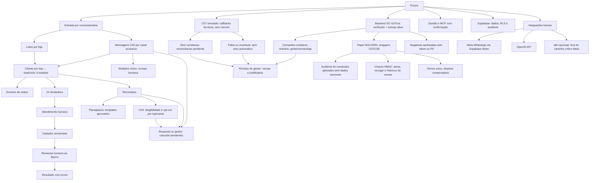
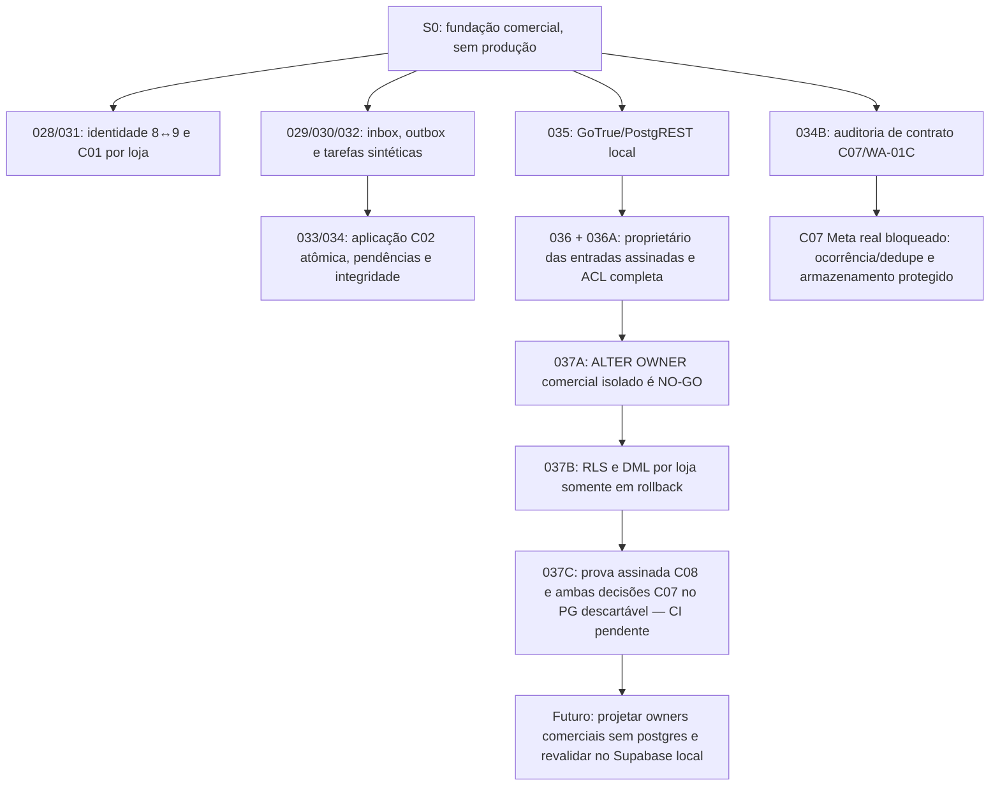

# Prumo — mapa mental simples

S0 fundação: telefone de cliente pode existir em A/B/C com históricos isolados; emissor Prumo exclusivo por loja; importação C01, ingresso C02, elegibilidade C04, planos C05 e cancelamento C08 simulados com eventos e idempotência; nenhuma transmissão externa. S0 testes sintéticos; S1 operação humana/banco simulados; S2 IA/Meta simulados; S3 MCP controlado; S4 ativação real somente por autorização específica. Não há IA Analista autônoma. Nenhum dado cruza lojas.

## Linha do tempo S0 auditada — 18/10/2026

### Decisões e fronteiras

- **[D] DEC-WA-01/02/03:** variantes telefônicas brasileiras com e sem nono dígito são aliases do mesmo contato **quando a associação é confiável e não ambígua na mesma loja**; o mesmo telefone pode existir em outras concessionárias com histórico independente. Reutilizar o domínio S0 e manter inbox/outbox transacionais. Nenhuma fusão automática de pessoas em conflito ou compartilhamento de histórico entre lojas.
- **[D] DEC-WA-05:** App/WABA/número emissor Meta pertencem à concessionária; a Prumo integra sob autorização. Um emissor é atribuído a apenas uma loja por vigência. Não modificar canais comerciais por inferência.
- **[P] WA-01C:** `statuses[].id` é ID da mensagem enviada, **não** ID único de ocorrência do callback; `status+timestamp` não prova deduplicação. C07 real permanece não integrado à inbox.
- **[R] DEC-WA-04/06:** ambiente definitivo, segredos, proteção/retensão de payload, recibo/ACK operacional e recuperação ainda exigem definição/autorização. A POC Meta não autoriza operação comercial.
- **[D] Meta → Supabase direto como direção de integração:** Edge Function autentica a origem, persistência durável antes de ACK, worker controlado, outbox e Graph; n8n opcional fora do caminho crítico, não um componente obrigatório.
- **[D] Oito estados comerciais somente:** `aguardando primeiro disparo`, `primeiro disparo enviado`, `em atendimento pela IA`, `em atendimento pelo operador`, `cadastro enviado ao operador`, `cadastro enviado ao banco`, `vendido`, `perdido`. `APPLIED`, `QUARANTINED`, estados Meta e leases são técnicos, não comerciais.
- **[R] Menor privilégio comercial integral:** gateway e assinador têm papéis NOLOGIN isolados; as **duas wrappers comerciais legadas ainda pertencem a `postgres`**. S0-037A/037B não autorizaram a transferência. S0-037C testa a cadeia existente, não instala papel operacional novo.
- **[Gate]** GitHub PR #1 e PR #2 permanecem Draft, sem merge; testes PostgreSQL descartável e Supabase Auth/REST local quando necessários; Supabase hospedado não recebeu as migrations comerciais, sem envio Meta/Banco real, nenhum plano pago ou deploy autorizado.

### Marcos e evidências

| Marco | Escopo | Evidência |
| --- | --- | --- |
| S0-033/034A | C02 ligado à inbox em uma transação; prova de conclusão, conflito de identidade durável e FKs por canal | PG17 aprovado, testes WA33/WA34 |
| S0-034B | C07 callbacks sintéticos, preservação de observações e dedupe **não operacional** | [CI #39119612194](https://github.com/prumogrowth/Prumo-Growth---Platform/actions/runs/39119612194) |
| S0-035 | GoTrue/PostgREST local para 028–034 | [CI #39120161917](https://github.com/prumogrowth/Prumo-Growth---Platform/actions/runs/39120161917) |
| S0-036/036A | Entradas assinadas com owner restrito, inventário completo de ACL | [CI #39122948236](https://github.com/prumogrowth/Prumo-Growth---Platform/actions/runs/39122948236) |
| S0-037A | Guard `current_user=postgres` e RLS bloqueiam transferência isolada | [CI #39123912355](https://github.com/prumogrowth/Prumo-Growth---Platform/actions/runs/39123912355) |
| S0-037B | Policies artificiais por loja e DML C07/C08 descartável | [CI #39126117200](https://github.com/prumogrowth/Prumo-Growth---Platform/actions/runs/39126117200) |
| S0-037C | Regressão do caminho assinado com HMAC, sessão, nonce, C08 e duas decisões C07 | **Teste proposto; aceite pendente do CI** |

O `MAPA_MENTAL.md` é índice de navegação. As decisões normativas e os registros de aceite versionados têm precedência sobre os nós simplificados deste mapa. Atualizá-lo a cada incremento **depois de verificar** CI e escopo real, sem rotular proposta como entregue.
