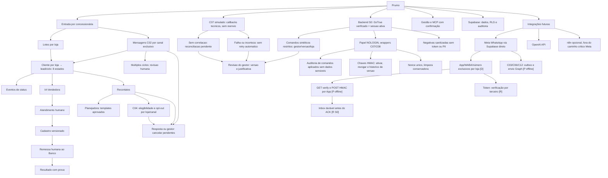
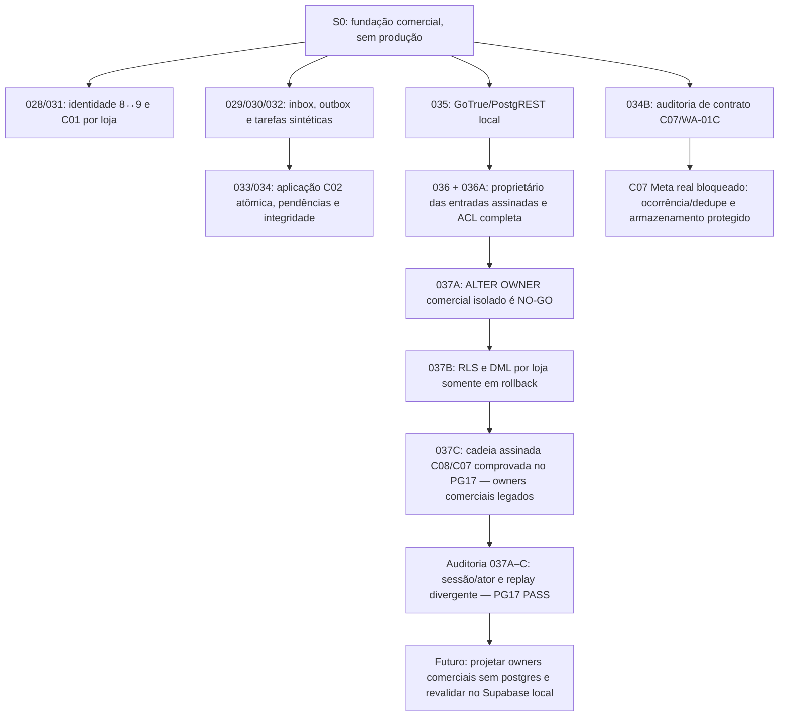
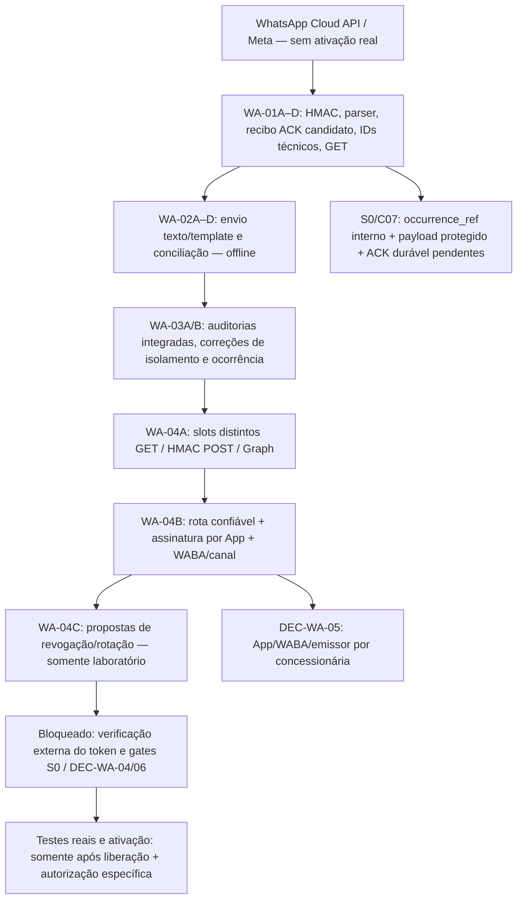

# Prumo — mapa mental simples

S0 fundação: telefone de cliente pode existir em A/B/C com históricos isolados; emissor Prumo exclusivo por loja; importação C01, ingresso C02, elegibilidade C04, planos C05 e cancelamento C08 simulados com eventos e idempotência; nenhuma transmissão externa. S0 testes sintéticos; S1 operação humana/banco simulados; S2 IA/Meta simulados; S3 MCP controlado; S4 ativação real somente por autorização específica. Não há IA Analista autônoma. Nenhum dado cruza lojas.

## Linha do tempo S0 auditada — 18/10/2026

### Decisões e fronteiras

- **[D] DEC-WA-01/02/03:** variantes telefônicas brasileiras com e sem nono dígito são aliases do mesmo contato **quando a associação é confiável e não ambígua na mesma loja**; o mesmo telefone pode existir em outras concessionárias com histórico independente. Reutilizar o domínio S0 e manter inbox/outbox transacionais. Nenhuma fusão automática de pessoas em conflito ou compartilhamento de histórico entre lojas.
- **[D] DEC-WA-05:** App/WABA/número emissor Meta pertencem à concessionária; a Prumo integra sob autorização. Um emissor é atribuído a apenas uma loja por vigência. Não modificar canais comerciais por inferência.
- **[P] WA-01C:** `statuses[].id` é ID da mensagem enviada, **não** ID único de ocorrência do callback; `status+timestamp` não prova deduplicação. C07 real permanece não integrado à inbox.
- **[R] DEC-WA-04/06:** ambiente definitivo, segredos, proteção/retensão de payload, recibo/ACK operacional e recuperação ainda exigem definição/autorização. A POC Meta não autoriza operação comercial.
- **[D] Meta → Supabase direto como direção de integração:** Edge Function autentica a origem, persistência durável antes de ACK, worker controlado, outbox e Graph; n8n opcional fora do caminho crítico, não um componente obrigatório.
- **[D] Oito estados comerciais somente:** `aguardando primeiro disparo`, `primeiro disparo enviado`, `em atendimento pela IA`, `em atendimento pelo operador`, `cadastro enviado ao operador`, `cadastro enviado ao banco`, `vendido`, `perdido`. `APPLIED`, `QUARANTINED`, estados Meta e leases são técnicos, não comerciais.
- **[R] Menor privilégio comercial integral:** gateway e assinador têm papéis NOLOGIN isolados; as **duas wrappers comerciais legadas ainda pertencem a `postgres`**. S0-037A/037B não autorizaram a transferência. S0-037C testa a cadeia existente, não instala papel operacional novo.
- **[Gate]** GitHub PR #1 e PR #2 permanecem Draft, sem merge; testes PostgreSQL descartável e Supabase Auth/REST local quando necessários; Supabase hospedado não recebeu as migrations comerciais, sem envio Meta/Banco real, nenhum plano pago ou deploy autorizado.

### Marcos e evidências

| Marco | Escopo | Evidência |
| --- | --- | --- |
| S0-033/034A | C02 ligado à inbox em uma transação; prova de conclusão, conflito de identidade durável e FKs por canal | PG17 aprovado, testes WA33/WA34 |
| S0-034B | C07 callbacks sintéticos, preservação de observações e dedupe **não operacional** | [CI #39119612194](https://github.com/prumogrowth/Prumo-Growth---Platform/actions/runs/39119612194) |
| S0-035 | GoTrue/PostgREST local para 028–034 | [CI #39120161917](https://github.com/prumogrowth/Prumo-Growth---Platform/actions/runs/39120161917) |
| S0-036/036A | Entradas assinadas com owner restrito, inventário completo de ACL | [CI #39122948236](https://github.com/prumogrowth/Prumo-Growth---Platform/actions/runs/39122948236) |
| S0-037A | Guard `current_user=postgres` e RLS bloqueiam transferência isolada | [CI #39123912355](https://github.com/prumogrowth/Prumo-Growth---Platform/actions/runs/39123912355) |
| S0-037B | Policies artificiais por loja e DML C07/C08 descartável | [CI #39126117200](https://github.com/prumogrowth/Prumo-Growth---Platform/actions/runs/39126117200) |
| S0-037C | Regressão do caminho assinado com HMAC, sessão, nonce, C08 e duas decisões C07 | [CI #39127146330 — SUCCESS](https://github.com/prumogrowth/Prumo-Growth---Platform/actions/runs/39127146330) |
| Auditoria S0-037A/B/C | Sessão e ator distintos, gestor interloja, replay C07 idêntico/divergente | [CI #39128133133 — SUCCESS](https://github.com/prumogrowth/Prumo-Growth---Platform/actions/runs/39128133133) |
| S0-037D | Capacidade de laboratório por operação/loja/alvo/versão/txid; GUC falsificada não é autorização | [CI #39130042204 — SUCCESS](https://github.com/prumogrowth/Prumo-Growth---Platform/actions/runs/39130042204) — **não é redução do owner comercial** |

**S0-037D testada no PostgreSQL 17:** capability de teste emitida pela fixture privilegiada, consumida em política RLS transacional sem confiar em GUC de sessão. Não há emissor autenticado e nem substituição das wrappers comerciais `postgres`. [CI PG17 #39130042204](https://github.com/prumogrowth/Prumo-Growth---Platform/actions/runs/39130042204) aprovado; emissão real e auditoria integral continuam pendentes. Ver `docs/S0_037D_CAPACIDADE_TRANSACIONAL_2026_10_18.md`.

O `MAPA_MENTAL.md` é índice de navegação. As decisões normativas e os registros de aceite versionados têm precedência sobre os nós simplificados deste mapa. Atualizá-lo a cada incremento **depois de verificar** CI e escopo real, sem rotular proposta como entregue.

## Acompanhamento vivo — WhatsApp/Meta WA-01 a WA-04 (18/10/2026)

**Convenção:** este mapa é um **índice**, não um aceite técnico. A cada incremento relevante realizado nas frentes, atualizar também a linha do tempo, os bloqueios e a evidência observada; não mover automaticamente um item de [P] para [V], [D] ou **produção**. A atualização ocorrerá durante as próximas atividades de desenvolvimento, **não em segundo plano**. Os documentos e testes de cada PR prevalecem sobre este resumo.

| Etapa | Situação em 18/10/2026 | Evidência e limite |
| --- | --- | --- |
| WA-01A/B/C/D | **[P]** Código candidato versionado no PR #2 | Assinatura do corpo bruto, GET, pistas técnicas **não autoritativas** e estrutura de ACK; nenhum recibo real COMMITTED |
| WA-02A/B/C/D | **[P/V local]** Construtores, envio Graph fictício e callbacks técnicos | Testes unitários sintéticos; **nenhum** HTTP Graph, retorno comercial ou persistência durável |
| WA-03A/B | **[P/V local]** Auditorias e reparos publicados | 120 testes na suíte WA-03B; corrigidos isolamento, posições dos arrays, HMAC/buffer e correlações; não é CI de produção |
| WA-04A/B | **[P/V local]** Roteamento confiável e slots segregados por App/canal | 167/167 testes locais na WA-04B (inclui regressões anteriores selecionadas); sem token real ou conexão Supabase |
| WA-04C | **[P/V local]** Propostas puras de revogação de App/canal e rotação de slots | 13 testes próprios + 10 novos testes adversariais WA-04; 235 testes no conjunto completo das frentes Meta (incluídos WA-01 legados). Propostas **não aplicadas**, App inativo na cópia; sem ativação |
| Credenciais Meta definitivas | **[R]** Dependência de **verificação por terceira pessoa** para liberar o token | **Não disponíveis** para esta frente; testes reais WhatsApp adiados; não pedir valores em Git, issue, chat ou arquivo |
| S0 ↔ Meta real | **[R]** Gate operacional pendente | Ambiente DEC-WA-04, segredos/rotação/ACK/retensão DEC-WA-06, registro App→loja/canal autenticado, payload protegido, `occurrence_ref`, autorização C03/C06/C12 e C07 |

**Ressalva de auditoria entre frentes (18/10/2026):** após o registro WA-04C 13/13, o PR #2 acrescentou o commit `c98f3609b18c93dbd7c4cc8d4a75fd527c2a8be5`, alterando `integrations/whatsapp-meta/credential-lifecycle.ts` para negar registros inválidos/não clonáveis. A evidência 13/13 corresponde ao código **anterior** e **não certifica esse novo HEAD** sem nova rodada de testes da frente Meta. O PR #1 não incorporou nem executou esse código. **[R] Regressão WA-04C após a alteração**; continuar proibidas credenciais reais, Graph e deploy.

**Fonte de navegação:** [PR #2 — frente WhatsApp/Meta](https://github.com/prumogrowth/Prumo-Growth---Platform/pull/2) e seus documentos `docs/integracoes/whatsapp-meta/wa04a-...`, `wa04b-...`, `wa04c-ciclo-credenciais-sem-token-v0_1.md`. **Coordenação S0:** [PR #1](https://github.com/prumogrowth/Prumo-Growth---Platform/pull/1), onde owners comerciais mínimos, RLS, Gateway e persistência/ocorrências C07 seguem seu próprio gate; não confundir CI PostgreSQL descartável ou Supabase **local** com implantação hospedada.

**Regra operacional preservada:** não usar a POC concessionária de demonstração como ambiente definitivo por inferência; nenhum merge, deploy, migração remota, webhook comercial ou número alterado. Mesmo depois da liberação do token, testes reais exigirão confirmação do projeto Supabase correto, das permissões/segurança e uma autorização específica.

**Auditoria complementar WA-01 a WA-04C (18/10/2026):** **235/235 testes sintéticos locais PASS** em **16 arquivos** (180 regressões anteriores + 10 novos adversariais WA-04 + **45 testes legados WA-01** reexecutados); TypeScript estrito **PASS** dos **11 módulos** e dos testes. O código WA-04C foi corrigido para recusar registros de App malformados/não clonáveis em vez de lançar exceção. Os hashes Git dos arquivos ensaiados foram conferidos. O diagrama **inicial** cresce apenas com cinco vínculos Meta relevantes para a arquitetura; detalhes técnicos permanecem nos documentos. **Nenhuma** aprovação de token, homologação Meta, commit durável S0 ou produção decorre desses testes.
