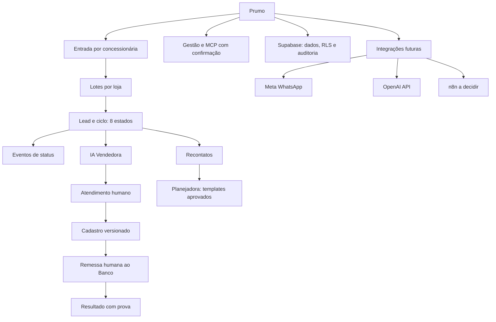

# Prumo — mapa mental simples

S0 fundação: importação transacional simulada, idempotência e eventos com versão; nenhum envio externo. S0 testes sintéticos; S1 operação humana/banco simulados; S2 IA/Meta simulados; S3 MCP controlado; S4 ativação real somente por autorização específica. Não há IA Analista autônoma. Nenhum dado cruza lojas.
