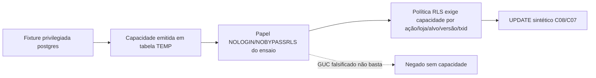

# S0-037D — protótipo descartável de autorização por capacidade, sem owner comercial novo

**Data:** 18/10/2026. **Estado inicial:** experimento **não homologado** até confirmação de CI. PR #1 continua Draft, sem merge/deploy. A migração 037 existente refere-se **somente** ao reparo S0-036A; esta S0-037D **não cria nova migration**.

## Pergunta técnica

A S0-037B mostrou que GRANT e RLS com UUID fixo de loja isolam registros de laboratório, **mas não autenticam sessão nem HMAC**. A S0-037C e a auditoria comprovam a cadeia assinada atual (HMAC, nonce, `auth.sessions`, gestor, versão, C08 e ambas decisões C07), **mas ela ainda usa `SECURITY DEFINER postgres`** nas duas wrappers comerciais. Uma política baseada apenas em `current_setting('loja')`, `current_setting('ator')` ou equivalente, controlável pelo chamador, não é uma alternativa segura.

Pergunta deste experimento: é possível restringir leitura e UPDATE a **operação, loja, alvo, versão e transação** associados a uma autorização protegida, ao mesmo tempo em que um parâmetro de sessão falsificado não concede direitos?

## Arquitetura do experimento, não de produção

O registro de capacidade é criado **deliberadamente pela fixture `postgres`**, com `acao`, `concessionaria_id`, `alvo_id`, `versao_esperada`, `txid_current()` e emissor `FIXTURE_POSTGRES`. O papel `prumo_s0_probe_037d` só recebe `SELECT` nesse registro, não INSERT/UPDATE/DELETE. As políticas de `public.planos_recontato_sinteticos` e `public.pendencias_reconciliacao_c07_sinteticas` usam `EXISTS` com comparação **explicitamente qualificada** da linha do domínio com o registro protegido; não confiam nas GUCs arbitrárias do cliente.

A role, a tabela temporária, as permissões, as policies e as linhas fictícias são criadas em **uma única transação do teste**, finalizada com `ROLLBACK`. A tabela TEMP **não** é arquitetura operacional: apenas existe na sessão de SQL do laboratório, e a fixture emitidora ainda é totalmente privilegiada. **Nenhum caller externo pode decidir quando ou como emiti-la em produção.**

## Marcadores executáveis

Em `supabase/tests/s0_037d_capacidade_transacional.sql`:

- **OWNER37D-01:** papel `NOLOGIN/NOBYPASSRLS` falsifica GUC `prumo.user_loja` e `prumo.user_acao`; não ganha leitura/escrita na loja B sem capacidade; INSERT de capacidade pelo papel é recusado.
- **OWNER37D-02:** fixture emite autorização apenas para operação `C08_CANCELAR` da loja A, alvo específico e versão 1 na transação atual; A pode atualizar essa linha uma vez; loja B, alvos distintos e replay da versão 1 não passam.
- **OWNER37D-03:** para pendências C07 distintas de A, capacidade `C07_ENCERRAR` admite somente `ENCERRAR_SEM_PROVA`, capacidade `C07_VINCULAR` admite somente `VINCULAR_SINTETICAMENTE` e loja B continua excluída. **Esses UPDATEs diretos são somente prova de ACL/policy**, não executam a lógica comercial C07 nem gravam associação/recibo/auditoria completa.
- **OWNER37D-04:** roles reais do gateway e executor continuam sem UPDATE comercial direto; as linhas da loja B e os controles comerciais antigos não são modificados. Toda concessão de laboratório desaparece ao final do teste.

## Achados antecipados e limites

1. **Capacidade não é credencial confiável por si só.** `txid_current()` limita a transação, mas quem controla o comando SQL na mesma transação **ainda pode executar qualquer UPDATE permitido pelo predicado enquanto aquela capacidade existir**. Isso não prova autorização fina de conteúdo, finalidade ou auditoria.
2. **Não existe emissor confiável de capacidade de menor privilégio** nesse protótipo. A fixture `postgres` não pode virar API, SQL de cliente, `SET ROLE` genérico nem mecanismo público de troca de owner. O emissor futuro precisa verificar HMAC/nonce, sessão GoTrue ativa/revogável, gestor, loja, versão e comando antes de qualquer escrita; a emissão/consumo devem ocorrer atomicamente.
3. C07 verdadeiro requer ambas as decisões, locks, associação callback/envio, auditoria de domínio e auditoria privada. C08 verdadeiro exige cancelamento atômico de plano, envios e eventos. Os UPDATEs isolados desta prova **não** substituem essa cadeia.
4. **Sem owner novo instalado.** As duas wrappers comerciais ainda pertencem a `postgres`; não basta mover a consulta privilegiada a outro `SECURITY DEFINER postgres` para afirmar que o privilégio foi reduzido.
5. A decisão futura precisa escolher uma interface única e restrita de operação confiável, sem grants DML a gateway, `authenticated` ou `service_role`; testar a matriz de concorrência, recusa de sessão/gestor e falhas entre escrita/auditoria; e validar no PostgreSQL 17 **e** no Supabase GoTrue/PostgREST local gerenciado.
6. C07 Meta real, recibo COMMITTED, proteção de payload, dedupe `statuses[].id`, DEC-WA-04/06, token real, app/WABA por concessionária DEC-WA-05 continuam gates separados.

**Decisão de engenharia:** S0-037D é uma prova de **limites e predicados RLS** que complementa S0-037B/C, não uma implementação comercial aprovada. Se passar no CI, **GO para desenho de emissor/transação autenticados em etapa posterior**, **NO-GO para reassinar owners, persistir as policies de teste, ativar ambiente hospedado, mesclar PRs ou produção.**

**Evidências finais:** acrescentar SHA e run apenas depois de verificação dos logs.
