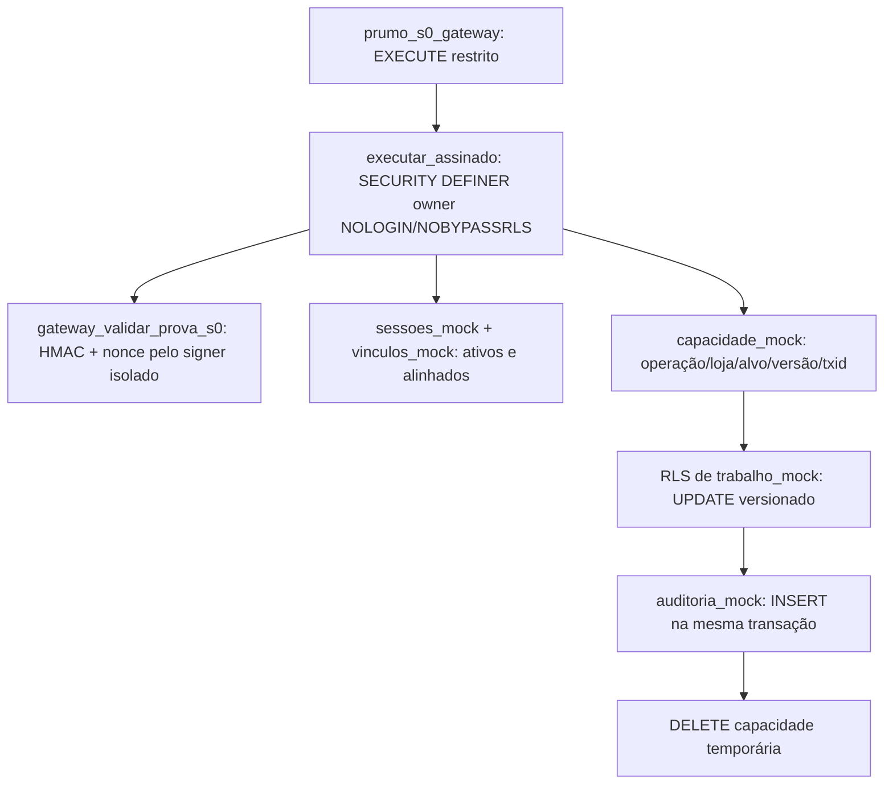

# S0-037F — Emissor e executor assinados com proprietário restrito: prova isolada

**Data:** 18/10/2026. **Tipo:** protótipo de segurança descartável em PostgreSQL 17, não migration ou implementação de produto. PR #1 Draft; não executar no Supabase hospedado.

## Objetivo e relação com os gates

A S0-037D demonstrou um predicado RLS associado a uma capacidade emitida por `postgres`, mas não implementou uma emissão de autorização vinculada à assinatura e sessão. A S0-037E confirmou a atomicidade do HMAC e da auditoria nas wrappers legadas `SECURITY DEFINER postgres`, sem reduzir esses privilégios. Esta S0-037F testa **um modelo separado**: função de execução cujo proprietário é role técnica **NOLOGIN/NOBYPASSRLS**, que recebe somente direitos delimitados sobre tabelas fictícias próprias, e chama o verificador HMAC existente (owner `prumo_s0_signer`). Ela cria a capacidade *dentro* da função, após verificar a sessão e o vínculo sintéticos; a RLS exige que ação/loja/alvo/versão/txid correspondam à capacidade.

## Arquitetura do ensaio

**Recursos descartáveis:** schema `prumo_037f_lab`, role `prumo_s0_probe_037f_exec`, tabelas fictícias `sessoes_mock`, `vinculos_mock`, `trabalho_mock`, `capacidade_mock`, `auditoria_mock`, função `executar_assinado`, grants, policies e chave HMAC determinística de fixture. Todo o script `supabase/tests/s0_037f_emissor_assinado_mock.sql` é `BEGIN...ROLLBACK`, executado **somente** pelo runner de banco descartável local. Não concede DML ao gateway ou aos papéis anon/authenticated/service_role; não abre funções do domínio C07/C08.

## Critérios executáveis

- **ISSUERF-01:** a função `SECURITY DEFINER` pertence à role não-login sem superpoderes; não tem SELECT direto em `auth.sessions` ou material HMAC; gateway não recebe DML nas tabelas fictícias. Verificação de acesso sem usar GUC fornecida pelo usuário.
- **ISSUERF-02:** HMAC falso bloqueado; HMAC válido, sessão e vínculo sintéticos corretos autorizam uma transição fictícia rotulada C08 e uma C07. Gestão A não altera objeto de B; consumo de nonce e auditoria coerentes, capacidade removida.
- **ISSUERF-03:** trigger artificial provoca falha na inserção da auditoria **depois** do UPDATE; a operação falha, a alteração de estado, o nonce e a capacidade são revertidos; a mesma assinatura/nonce pode ser usada uma única vez após remover a falha.
- **ISSUERF-04:** sessão de fixture revogada bloqueia comando com HMAC válido; confirma 3 auditorias/3 transições/3 nonces válidos, a loja B inalterada e nenhuma capacidade remanescente.

## O que esta prova **não** homologa

O protótipo não lê `auth.sessions` verdadeiro nem testa JWT, RLS comercial integral ou locks transacionais de revogação; usa tabelas **mock**, com papel e políticas próprios. As escritas C07/C08 são apenas `trabalho_mock` de estado e versão, não cancelam envios de verdade, não fazem associação C07 real, não aplicam os oito status comerciais e não acionam Meta/Banco. A assinatura usa **apenas chave fictícia** e o validador HMAC já testado; o esquema foi criado por `postgres` dentro da fixture, mas a execução assinada da função é de um proprietário restrito. Essa diferença comprova viabilidade do padrão no laboratório, **não** prova que os owners comerciais legados podem ser transferidos sem redesenho de acesso a `auth.sessions`, locks, grants, RLS e auditoria real.

O modelo ainda carece de proteção contra concorrência entre verificação e revogação de sessão reais, autorização de gestor da concessionária para todas as operações, prova de completa atomicidade comercial e regressão sob GoTrue/PostgREST gerenciado. O legado continua `SECURITY DEFINER postgres`. Nenhuma policy/grant/role/mock table é instalada por migration.

**Condições de continuidade:** após CI PG17, auditar o protótipo e, somente com desenho compatível de acesso mínimo à sessão e domínio, propor migração nova sob autorização explícita. PRs #1/#2 Draft, sem merge; DEC-WA-04/06 e integração Meta real continuam bloqueados.

## Aceite confirmado — 18/10/2026

**[GitHub Actions PostgreSQL 17 #39131575891 — SUCCESS](https://github.com/prumogrowth/Prumo-Growth---Platform/actions/runs/39131575891)**, código executável testado no commit `2d02c55cc6c02ce695d14e03fa4c90a943d41d8a`. Logs verificados: `ISSUERF-01..04 PASS`, testes e concorrência anteriores sem regressão, **24 unitários Python OK**.

**Falha intermediária:** [CI #39131498734 — FAILURE](https://github.com/prumogrowth/Prumo-Growth---Platform/actions/runs/39131498734) encontrou apenas uma checagem de `has_table_privilege(..., 'auth.sessions')` sobre relação inexistente no bootstrap do PG17 isolado. O teste passou a consultar o privilégio somente quando `to_regclass('auth.sessions')` não é nulo; não modificou o mock, o verificador HMAC, as migrations ou o banco hospedado.

**Interpretação:** foi demonstrado em laboratório que o proprietário da função experimental pode ser NOLOGIN/NOBYPASSRLS, aplicar prova HMAC assinada via `prumo_s0_signer`, consultar sessão/vínculo fictícios, emitir capacidade na própria transação, gravar estado e auditoria juntos, bloquear loja B e reverter nonce/estado diante de falha na auditoria. **Não** foi demonstrada autorização com `auth.sessions` GoTrue real, locks de revogação, domínio C07/C08 real, nem menor privilégio ponta a ponta das wrappers comerciais legadas. A última rodada integrada GoTrue/PostgREST da baseline real é [#39122948236 — SUCCESS](https://github.com/prumogrowth/Prumo-Growth---Platform/actions/runs/39122948236), não repetida nesta prova sem migration operacional. 
